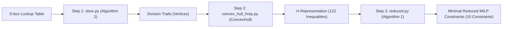

# Division Trail Modeling & Inequality Reduction for S-boxes

This project implements an end-to-end pipeline to generate, model, and reduce division trail linear inequalities for block cipher S-boxes using Mixed-Integer Linear Programming (MILP) techniques.

The methodology is based on the paper:
> **"Applying MILP to Division Property: An Approach for Division Trails"**  
> *Ling Sun, Wei Wang, Meiqing Wang* (IACR ePrint 2016/857 / ASIACRYPT 2016)

---

## 🚀 Features

- **Pure Python / SciPy Implementation**: Completely eliminates the need for SageMath. Runs in standard Python 3 using `scipy.spatial.ConvexHull`.
- **Automatic Division Trail Generation (Algorithm 2)**: Computes the Algebraic Normal Form (ANF) and bit-product properties to deduce all valid division trails for any $n$-bit S-box.
- **Convex Hull H-Representation**: Computes facet-defining boundary hyperplanes in $\mathbb{R}^{2n}$ and normalizes them into exact coprime integer inequalities.
- **Greedy Inequality Reduction (Algorithm 1)**: Filters out redundant inequalities by iteratively selecting the constraint that eliminates the maximum number of invalid division patterns.
- **Clean MILP Format Output**: Outputs constraints directly in algebraic format ready for solvers like Gurobi, CPLEX, or SCIP.

---

## 📁 File Structure

```text
.
├── main.py              # Main execution pipeline (Input S-box -> Final Reduced Inequalities)
├── sbox.py              # Algorithm 2: S-box ANF & Division Trails generator
├── convex_hull_hrep.py  # Convex Hull H-representation computation (via SciPy) & formatting
├── reduced.py           # Algorithm 1: Greedy inequality size reduction
├── Makefile             # Convenient build/run targets
└── README.md            # Project documentation
```

---

## 🛠️ Requirements

- **Python 3.8+**
- **NumPy**
- **SciPy**

Install dependencies with:
```bash
pip install numpy scipy
```

*(Note: SageMath is **not** required.)*

---

## ⚡ Quick Start

Run the entire pipeline:

```bash
make run
```
or directly via Python:
```bash
python3 main.py
```

---

## 🔄 Pipeline Workflow

The pipeline executes in three sequential stages:



### 1. Step 1: Division Trail Generation (`sbox.py`)
Computes the Algebraic Normal Form (ANF) of all coordinate functions and their products using the Fast Moebius Transform. It then determines valid transitions $(a \to b)$ through the S-box:
$$\mathbf{a} = (a_{n-1}, \ldots, a_0) \longrightarrow \mathbf{b} = (b_{n-1}, \ldots, b_0)$$

For PRESENT S-box, it produces all **47 division trails** (Table 4 of the paper).

### 2. Step 2: H-Representation Computation (`convex_hull_hrep.py`)
Treats the division trails as vertices in $\{0, 1\}^{2n}$ and computes the convex hull $\text{Conv}(A)$ using `scipy.spatial.ConvexHull`. The facet-defining hyperplanes:
$$\mathbf{A} \cdot \mathbf{x} + c \ge 0$$
are converted into exact coprime integer coefficients (yielding **122 linear inequalities** for PRESENT).

### 3. Step 3: Greedy Inequality Reduction (`reduced.py`)
Identifies all invalid division patterns $B = \{0, 1\}^{2n} \setminus A$. It iteratively chooses the inequality that invalidates the largest subset of remaining invalid patterns until all patterns in $B$ are eliminated.

For PRESENT, this reduces the system from **122 down to 10 essential inequalities**.

---

## 📊 Sample Output (PRESENT S-box)

```text
================================================================================
DIVISION TRAIL & INEQUALITY MODELING PIPELINE FOR PRESENT S-BOX
================================================================================
S-box lookup table: [12, 5, 6, 11, 9, 0, 10, 13, 3, 14, 15, 8, 4, 7, 1, 2]

================================================================================
STEP 1: DIVISION TRAILS OF THE S-BOX (47 trails)
================================================================================
Trail   1: (0, 0, 0, 0) -> (0, 0, 0, 0)  [0, 0, 0, 0, 0, 0, 0, 0]
Trail   2: (0, 0, 0, 1) -> (0, 0, 0, 1)  [0, 0, 0, 1, 0, 0, 0, 1]
...
Trail  47: (1, 1, 1, 1) -> (1, 1, 1, 1)  [1, 1, 1, 1, 1, 1, 1, 1]

================================================================================
STEP 2: GENERATED H-REPRESENTATION INEQUALITIES (122 constraints)
================================================================================
Constraint   1: -5a3 - 5a2 - 5a1 - 2a0 + b3 + 2b2 + b1 + 2b0 + 11 >= 0
Constraint   2: -4a3 - 4a2 - 4a1 - 2a0 + b3 + b2 + b1 + 2b0 + 9 >= 0
...
Constraint 122: 3a3 - b3 - b2 - b1 - b0 + 1 >= 0

================================================================================
STEP 3: REDUCED INEQUALITIES (10 constraints)
================================================================================
Constraint  1: a3 + a2 + a1 + a0 - b3 - b2 - b1 - b0 >= 0
Constraint  2: -4a3 - a2 - a1 - 4a0 + 2b3 + 2b2 + 2b1 - 3b0 + 7 >= 0
Constraint  3: 3a3 - b3 - b2 - b1 - b0 + 1 >= 0
Constraint  4: -3a3 - 3a2 - 3a1 + b3 + 2b2 + b1 + 2b0 + 5 >= 0
Constraint  5: 3a1 - b3 - b2 - b1 - b0 + 1 >= 0
Constraint  6: 3a2 - b3 - b2 - b1 - b0 + 1 >= 0
Constraint  7: -2a3 - a2 - a1 - 2a0 + 5b3 + 5b2 + 5b1 + 2b0 >= 0
Constraint  8: -4a2 - 4a1 - 2a0 + b3 - 3b2 + b1 + 2b0 + 9 >= 0
Constraint  9: -a3 - a2 - a1 - b3 + b1 + 3 >= 0
Constraint 10: -a3 - a2 - a1 + b3 - b1 + 3 >= 0
================================================================================
```

---

## 🔧 Testing Other S-boxes

To analyze a different cipher, open [`main.py`](file:///home/anup/Desktop/re-search/division_trail/main.py) and change the `sbox` list:

```python
# Example: GIFT cipher S-box
cipher_name = "GIFT"
sbox = [0x1, 0xa, 0x4, 0xc, 0x6, 0xf, 0x3, 0x9, 0x2, 0xd, 0xb, 0x7, 0x5, 0x0, 0x8, 0xe]

# Example: CRAFT cipher S-box
# cipher_name = "CRAFT"
# sbox = [0xc, 0xa, 0xd, 0x3, 0xe, 0xb, 0xf, 0x7, 0x8, 0x9, 0x1, 0x5, 0x0, 0x2, 0x4, 0x6]
```
